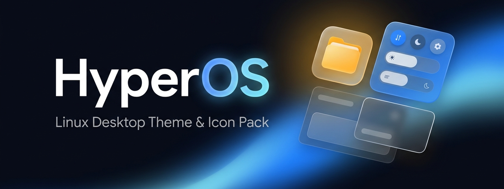
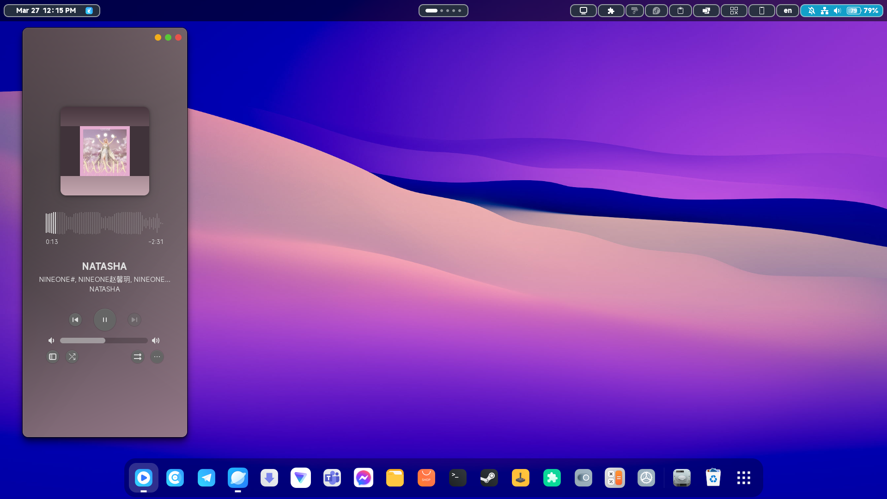
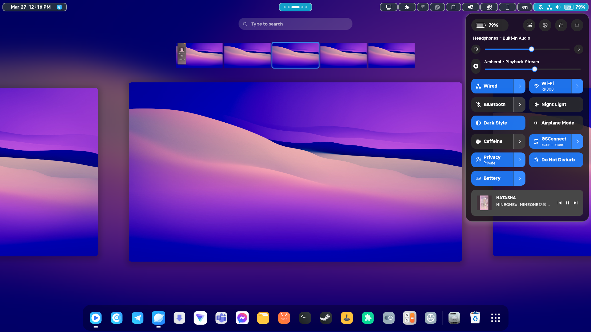
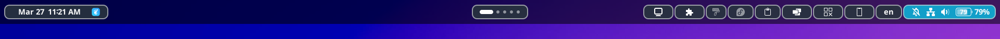

<div align="center">



# HyperOS Linux Theme & Android-to-Linux Icon Converter

A HyperOS-inspired Linux desktop theme and automated **Android HyperOS/MIUI/MTS → Freedesktop Linux Icon Theme** conversion pipeline, built and tested for **Fedora / Ultramarine Linux** (Wayland-first) and compatible with **GNOME, KDE Plasma, XFCE, Cinnamon, and MATE**.

</div>

---

## What's Included

- **Freedesktop Linux Icon Theme (`HyperOS-Icons/`)**: Multi-size (`16x16` through `256x256`) RGBA PNG and `scalable/` SVG icon theme with valid `index.theme`, relative symlink aliases, and GTK icon cache support.
- **Automated Conversion Pipeline (`scripts/hyperos_converter/`)**: Modular Python + Pillow workflow that scans Android icon packs, deduplicates assets (SHA-256 + perceptual dHash), reads Android XML metadata and host Linux `.desktop` entries, maps packages intelligently, converts images losslessly with transparency preserved, builds `index.theme`, validates the output, and generates an interactive HTML preview gallery.
- **Original Artwork Separation (`sources/original/`)**: Dedicated high-priority directory for Jawad's original HyperOS-inspired icons so custom artwork is never overwritten by third-party Android packs.
- **HTML Preview & QA Gallery (`reports/preview-gallery.html`)**: Searchable, filterable side-by-side comparison of original Android icons vs. converted Linux icons with light/dark transparency checkerboard toggle.
- **Complete Desktop Suite**:
  - **GTK / GNOME Shell Theme**: `Hyperos-Dark/`
  - **Legacy Reversal-based Icons**: `hyperos icons/` (preserved for backward compatibility)
  - **Sounds**: `hyperos sounds/`
  - **Fonts**: `font/MiSans_Arabic/`, `font/MiSans_Latin/`
  - **GNOME Shell Extensions**: `extenstions/` (note: `openbar@neuromorph` includes a built-in HyperOS style)

---

## Supported Desktop Environments

`HyperOS-Icons` follows the [Freedesktop.org Icon Theme Specification](https://specifications.freedesktop.org/icon-theme-spec/latest/) and works on:

- **GNOME** (Wayland & X11 — selectable in GNOME Tweaks or via `gsettings`)
- **GTK 3 / GTK 4 applications**
- **KDE Plasma**
- **XFCE**
- **Cinnamon**
- **MATE**
- Any other desktop environment implementing the Freedesktop Icon Theme Specification

No X11-only tools are required; all scripts are **Wayland-compatible**.

---

## Quick Start (Fedora / Ultramarine Linux)

### Prerequisites

```bash
sudo dnf install python3 python3-pillow gtk-update-icon-cache
```

### 1. Build & Validate the Linux Icon Theme

```bash
./build.sh
./validate.sh
```

This scans `sources/original/`, `hyperos3-icons/`, and `sources/android/`, generates `HyperOS-Icons/`, updates the GTK icon cache, writes conversion/unresolved/duplicate/licensing reports in `reports/`, and generates `reports/preview-gallery.html`.

### 2. Install the Icon Theme

```bash
# User installation (~/.local/share/icons/HyperOS-Icons) — recommended
./install.sh --user

# User installation + updated Hyperos-Dark GNOME Shell theme + apply immediately (Wayland-safe)
./install.sh --user --with-shell --apply

# System-wide installation (/usr/share/icons/HyperOS-Icons)
./install.sh --system --with-shell
```

Then select **HyperOS** in **GNOME Tweaks** → *Appearance* → *Icons* (or your desktop environment's icon theme settings).

### 3. Uninstall

```bash
./uninstall.sh --user     # Remove user installation
./uninstall.sh --system   # Remove system-wide installation
./uninstall.sh --all      # Remove both
```

---

## Preview & Quality Control

After running `./build.sh`, open the interactive HTML preview gallery in your browser:

```text
reports/preview-gallery.html
```

Features:
- **Side-by-side visual comparison** (Original Android icon vs. Converted Linux icon)
- **Live search** by filename, Android package name, Linux icon name, or alias
- **Category & status filters** (`apps`, `places`, `status`, `devices`, `mapped`, `unresolved`, `excluded`)
- **Light / dark transparency checkerboard toggle** to inspect alpha edges quickly
- **Metadata & provenance badges** (resolution, format, aliases, license status)

### Conversion Reports

Every build writes up-to-date reports into `reports/`:
- [`reports/conversion-report.md`](reports/conversion-report.md) & `conversion-report.json` — full conversion summary and per-icon table
- [`reports/unresolved-icons.md`](reports/unresolved-icons.md) & `unresolved-icons.csv` — Android icons intentionally left unmapped (never guessed)
- [`reports/duplicates-report.md`](reports/duplicates-report.md) — SHA-256 exact duplicates and perceptual dHash visually similar pairs
- [`reports/licensing-audit.md`](reports/licensing-audit.md) — provenance and redistribution review checklist

---

## Supported Icon Formats

- **Raster inputs**: `.png`, `.webp`, `.jpg`, `.jpeg`, `.bmp`, `.ico` (converted to crisp, lossless RGBA `.png` across `16x16`, `24x24`, `32x32`, `48x48`, `64x64`, `96x96`, `128x128`, `256x256` without upscaling or stretching)
- **Vector inputs**: `.svg` (validated as XML and preserved in `scalable/<context>/`)
- **Archives**: `.mtz` and `.zip` Android theme archives dropped into `sources/android/` are extracted safely in a temporary directory during build

---

## How to Add New Android Icon Packs or Original Icons

### Adding Original HyperOS-Inspired Icons (Highest Priority)

Place your own `.svg` or `.png` icons into `sources/original/<context>/` (e.g., `sources/original/apps/firefox.svg`) and rebuild:

```bash
./build.sh
./validate.sh
```

Original artwork in `sources/original/` always takes priority and is never overwritten by Android pack icons.

### Adding New Android / HyperOS / MTS Icon Packs

1. Copy the extracted icon folder (or `.mtz` / `.zip` archive) into `sources/android/<pack-name>/`.
2. Run `./build.sh` and `./validate.sh`.
3. Inspect `reports/unresolved-icons.md` for any new Android packages that need explicit Linux mappings.
4. Add verified mappings to `scripts/hyperos_converter/mappings/android_to_linux.json` and re-run `./build.sh`.
5. Record the pack's creator, source URL, and license in [`CREDITS.md`](CREDITS.md).

---

## Installing the Rest of the HyperOS GNOME Suite

### GTK + GNOME Shell Theme (`Hyperos-Dark`)

```bash
mkdir -p ~/.themes
cp -r Hyperos-Dark ~/.themes/
```

### Sounds (`hyperos sounds`)

```bash
mkdir -p ~/.local/share/sounds
cp -r "hyperos sounds" ~/.local/share/sounds/
```

### Fonts (`MiSans`)

```bash
mkdir -p ~/.local/share/fonts
cp -r font/MiSans_Arabic ~/.local/share/fonts/
cp -r font/MiSans_Latin ~/.local/share/fonts/
fc-cache -f
```

### GNOME Shell Extensions (`extenstions/`)

```bash
mkdir -p ~/.local/share/gnome-shell/extensions
cp -r extenstions/* ~/.local/share/gnome-shell/extensions/
```

Log out and log back in (on Wayland, `Alt+F2` → `r` is not supported), then enable extensions in `gnome-extensions-app`.

---

## Screenshots





---

## Attribution & Licensing

See [`CREDITS.md`](CREDITS.md) for complete attribution across:
- Original work by Jawad (`iijawadm`)
- HyperOS / MIUI / MTS Android theme sources
- Third-party icon creators (`Reversal-icon-theme`, `OSX_ONE`) and GNOME Shell extensions
- Independently modified components
- Assets with unverified ownership or licensing flagged for review

---

## Known Limitations

- **Regional / mobile-only Android apps**: Apps without a Linux desktop equivalent (e.g., mobile banking, carrier, or regional shopping apps) are intentionally placed in `reports/unresolved-icons.md` rather than blindly renamed.
- **Raster-only Android packs**: Android `.png`/`.webp` sources are downscaled crisply to all standard sizes up to their native resolution (`256x256`) and are never upscaled into blurry assets; true vector scaling requires `.svg` sources.
- **Third-party redistribution review**: `hyperos3-icons/`, `hyperos sounds/`, `font/`, and `backgrounds/` contain third-party assets whose redistribution licenses must be verified before publishing derivative packs (see [`CREDITS.md`](CREDITS.md) and [`reports/licensing-audit.md`](reports/licensing-audit.md)).
